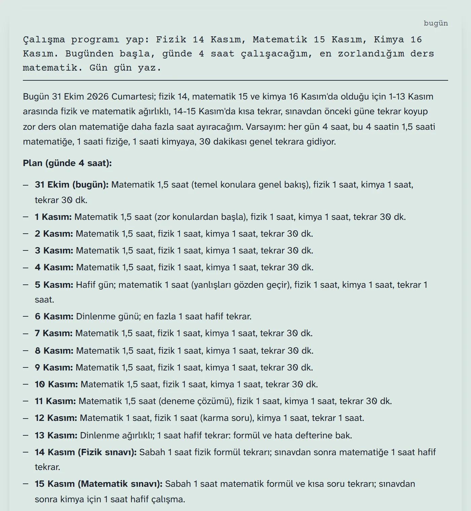
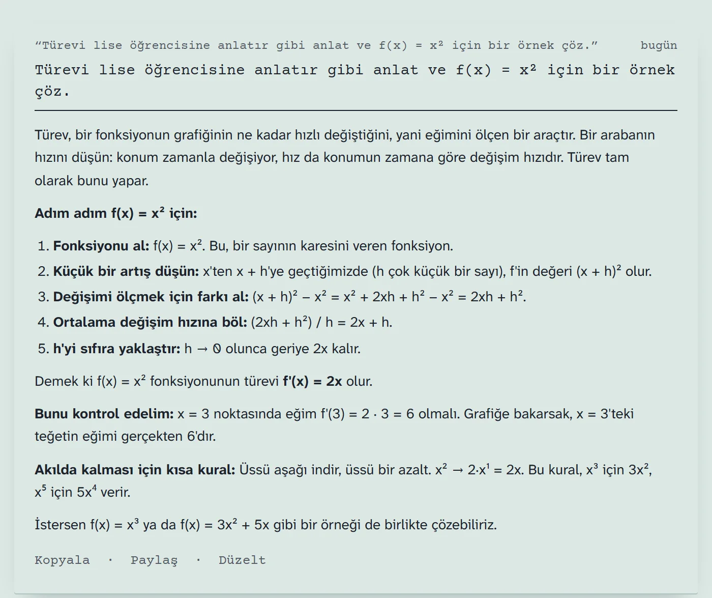
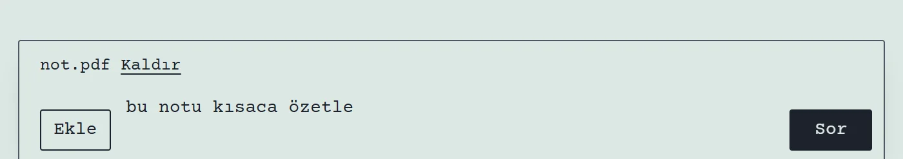
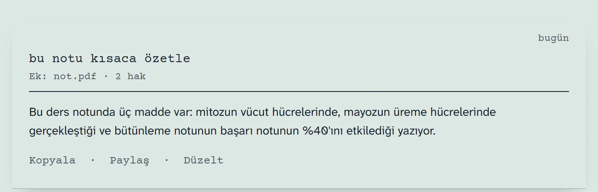
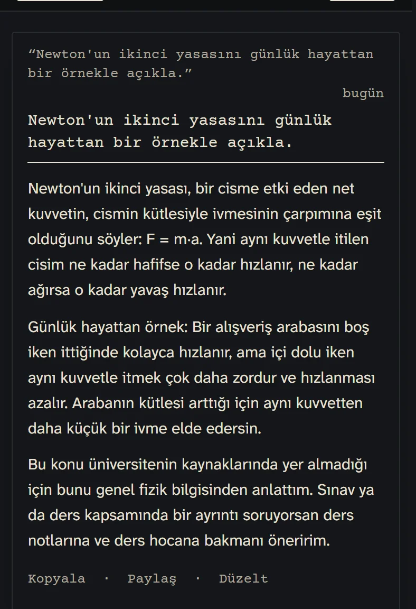

# Hüma

Üniversite öğrencileri için sohbet eden, kaynak gösteren yapay zekâ asistanı. Öğrencinin sorularını üniversitenin herkese açık sayfalarında ve yönetmeliklerinde arayıp cevabın hangi sayfaya dayandığını gösterir. Ders anlatır, çalışma programı hazırlar, eklenen fotoğraf ve PDF'leri okur.

Bağımsız bir öğrenci projesidir, herhangi bir üniversitenin resmî hizmeti değildir. Bu depo yalnız tanıtım içindir; kaynak kod gizlidir.

> **Hüma'ya git:** https://terminology-instant-guides-costumes.trycloudflare.com
>
> **Erişim:** Hüma herkese açık değildir. Yalnız Yusuf Baran Ozmakgil'den alınan şifre ile girilebilir.
>
> Deneme sürümüdür; geliştiricinin bilgisayarı kapalıyken açılmaz, adres zaman zaman değişebilir.

## Ekran görüntüleri

Görüntüler uygulamanın kendisinden alındı, cevaplar gerçek model cevaplarıdır. PDF örneği deneme amaçlı küçük bir nottur.

**Çalışma programı**

**Ders anlatımı**

**Fotoğraf ve PDF ekleme**

**Telefon, koyu tema**

## Neler yapıyor

- Üniversite sorularını taranmış sayfalarda arar, kaynağını gösterir; kaynakta yoksa uydurmak yerine bulamadığını söyler
- Sohbet eder, ders anlatır, örnek çözer, gün gün çalışma programı hazırlar
- Fotoğraf ve PDF okur; PDF'in kelime sayısına göre daha çok mesaj hakkı düşer
- Bölüm, sınıf gibi notları sonraki sohbetlerde hatırlar
- Sohbetler ve dosyalar sunucuda saklanmaz

## Teknik özet

| Katman | Kullanılan |
|---|---|
| Veri toplama | Python, robots.txt kurallarına uyan tarayıcı |
| Arama | SQLite FTS5 kelime araması + e5-small anlam araması |
| Cevap | Claude Haiku 5.5, araç kullanımı, akarak yazım, kaynak atıfları |
| Sunucu | FastAPI |
| Arayüz | Çerçevesiz HTML, CSS ve JavaScript |
| Kalite | 177 otomatik test, 147 soruluk ölçüm seti, genel soru seti, GitHub Actions |

## Ölçülen sonuçlar

147 soruluk test setiyle, 31 Ekim 2026:

| Ölçü | Sonuç |
|---|---|
| İlk kelimeye kadar süre (ortanca) | 1,67 sn (14 soruluk tekrar ölçümü) |
| Hakem puanı: doğru / kısmen / yanlış | 108 / 39 / 0 |
| Yanlışlıkla genel sayılan üniversite sorusu | 0 |

147 soruluk ölçümün ortasında API yavaşladığı için süre orada 2,08 sn çıktı; bu yüzden aynı sorulardan 14'ü yeniden ölçüldü. Puanlar başka bir yapay zekâ hakeminden gelir, bağımsız bir sınav değildir. Sorular geliştirme sırasında görüldü; gerçek kullanıcılarla ölçüm henüz yapılmadı.

## Geliştiren

Yusuf Baran Ozmakgil
